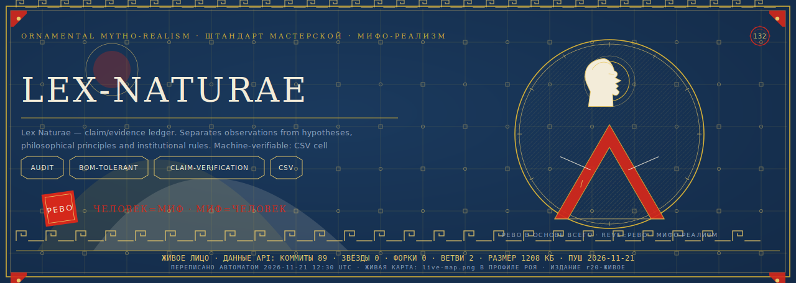
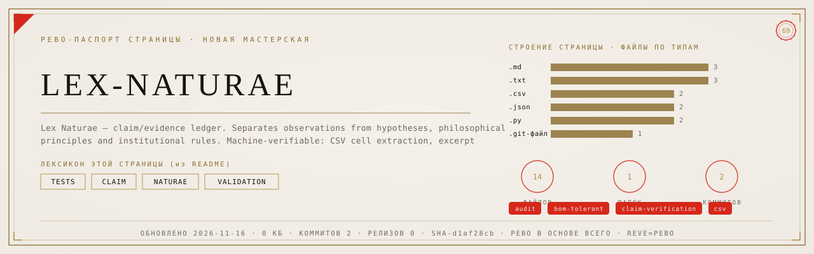

<div align="center">

<a href="https://github.com/rtynbirf/lex-naturae"></a>

</div>

<div align="center">
  
</div>

<!--ФОРЖ:ПАСПОРТ:НАЧАЛО-->
<div align="center">
  
</div>

| ФАЙЛОВ | ПАПОК | КОММИТОВ | ОБНОВЛЕНО | РЕЛИЗОВ |
|---:|---:|---:|---|---:|
| 67 | 12 | 102 | 2026-11-24 | 0 |
<!--ФОРЖ:ПАСПОРТ:КОНЕЦ-->

<div align="center">
  
</div>

# Lex Naturae

**Claim/evidence ledger.** Separates observations from hypotheses, philosophical principles and institutional rules. Machine-verifiable: CSV cell extraction, excerpt verification, SHA-256 artifact integrity, unit ranges, graph conflict detection.

> «Не пытаться программно удостоверять истину, а проверять то, что действительно доступно машинной проверке.»

## Что проверяет

- **CSV cell extraction:** `measurement_value` извлекается из указанной ячейки CSV и сравнивается с заявленным с допуском (≤1% от значения).
- **Excerpt verification:** цитата проверяется по тексту файла (NFKC, whitespace-collapsed, verbatim).
- **SHA-256 artifact integrity:** хеш пересчитывается от файла, не от заявленной строки.
- **Unit ranges и compatibility:** единицы привязаны к величинам (`degC` → `temperature`, не `length`); диапазоны отклоняют `-5000 K` и `1e308 J`.
- **Graph conflict detection:** `contradicts` между двумя `SUPPORTED` в одном scope → предупреждение; ограниченная эвристика отрицания.
- **Deduplication:** один файл = одно свидетельство, даже если повторён 5 раз.
- **Date validation:** `retrieved_at` — ISO 8601, 1900–now, без будущих дат.
- **BOM tolerance:** JSON с UTF-8 BOM парсится корректно (v0.7 fix).

## Чего НЕ проверяет (осознанные границы)

- Истинность утверждений (программа не доказывает, что цитата означает то, что утверждает claim)
- Подлинность документа по URL (маркируется `UNVERIFIED_SUBMITTER_ASSERTION`)
- Что эксперимент действительно проводился
- Семантические синонимы областей действия
- Независимость источников (дедупликация по хешу, не по происхождению)

## Запуск

```bash
# Single claim from stdin
echo '{"claim_id":"X","statement":"...","kind":"observation","scope":"s","status":"UNKNOWN"}' | python lex_naturae.py -

# Collection from file
python lex_naturae.py example_collection.json

# Tests
python -m pytest test_lex_naturae.py -q    # 70/70
```

## Версии

| Версия | Что добавлено |
|---|---|
| v0.7 | BOM tolerance (Z.ai independent audit fix); 70 tests |
| v0.6 | Excerpt verification, tolerance cap, CSV hardening, crash resistance; 68 tests |
| v0.5 | measurement↔CSV cell link, unit ranges, date validation, deduplication; 48 tests |
| v0.4 | SHA-256 file verification, controlled units, scope normalization; 31 tests |
| v0.3 | Structured evidence methods, link matrix, graph validation; 24 tests |
| v0.2 | Link relations, method blacklist, MIXED for philosophy; 18 tests |
| v0.1 | Initial prototype: 4 claim kinds, status validation; 11 tests |

## Аудит

Независимый аудит v0.6→v0.7 выполнен Z.ai (не автором v0.6). 20 атак, не входящих в 68 тестов автора. 19 отбиты v0.6; 1 gap (BOM) исправлен в v0.7. Отчёт: [`AUDIT-REPORT.md`](AUDIT-REPORT.md).

## Лицензия

MIT.
